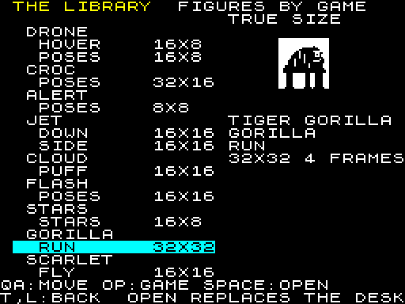

# Sprite Studio

[](LICENSE)
[-CC%20BY--NC%204.0-lightgrey.svg)](LICENSE-ASSETS.md)
[](#run-it)
[-orange.svg)](game/src/)
[](game/tools/)
[](https://youtu.be/kdW7khOQViU)

Joo's Sprite Studio is a sprite editor for the ZX Spectrum 128K, written in Z80 assembly. You draw a sprite
square by square, as on squared paper, and see each row's bytes in hex beside it. You see it at true size,
add frames and play them as a flip-book. You can work out its mask, and test it over scenery to see colour
clash and flicker. You can keep up to eight figures on a sheet, save them to tape, or export them as `DEFB`
lines for your own game. It works with keys, a Kempston joystick or a Kempston mouse.





## Run it

1. Get the tape: [`game/build/sprite-studio-m7.tap`](game/build/sprite-studio-m7.tap). It is the latest
   milestone (M7). The tapes for M1 to M6 beside it are earlier versions.
2. Load it on a **128K** Spectrum or a +2. It does not run on a 48K.
3. In the [Fuse](https://fuse-emulator.sourceforge.net/) emulator, with a Kempston mouse:

   ```sh
   fuse --machine 128 --kempston-mouse game/build/sprite-studio-m7.tap
   ```

   Click the Fuse window to let it take the mouse. Other emulators with 128K and Kempston support should
   also work.
4. On the Start screen press **1** for the mouse, or **2** for keys or a joystick.

## Controls

The [user guide](docs/studio-guide.md) lists every control. The main keys on the Desk:

| Key | Does |
| --- | --- |
| Q A O P | move the Grid Cursor (or use a Kempston stick) |
| SPACE / ENTER | paint / rub out (mouse: left / right button) |
| U | undo; press again to redo |
| Z / X | previous / next frame |
| C / V / R | copy / delete / clear the frame |
| G | play or stop the flip-book (J / K: slower / faster) |
| N | tracing paper: the last frame shows as rings |
| I | mirror the frame |
| D | switch between the picture and its mask (F: the mask style) |
| H | the Test Ground: the figure over scenery, with colour clash |
| L | the Library of ready-made figures |
| 0 | the Lessons |
| 9 | the Sheet: several figures, save and load on tape, export |
| T | back |
| M | music on or off (Start screen) |

## The tutorial

Joo, the studio's sprite artist, shows the Studio and its six lessons in a four-minute video:
<https://youtu.be/kdW7khOQViU>. The same video is in this repository as
[`game/video/tutorial.mp4`](game/video/tutorial.mp4).

## Build it from source

The source is in [`game/src/`](game/src/): `main.asm` and the files it includes, for
[sjasmplus](https://github.com/z00m128/sjasmplus) 1.24.0. To assemble it:

```sh
tools/build.sh                       # or: SJASMPLUS=/path/to/sjasmplus tools/build.sh
```

This writes `build/main.bin` (the program) and `build/bank1.bin`, `bank4.bin` and `bank6.bin` (the 128K
memory banks). It then checks their sha256 against [`tools/build.sha256`](tools/build.sha256): they are the
exact code inside `game/build/sprite-studio-m7.tap`.

**What needs private tools.** The Studio was built with a set of private Claude Code plugins. These parts of
the work use them, and are not needed to assemble or run the Studio:

- packing the assembled code into the `.tap`, with its BASIC loader (the committed tapes are the result);
- the emulator checks in [`game/tools/`](game/tools/) and the bot recipes in `game/recipes/`, which run the
  tape in the plugins' Z80 simulator (their results are in `game/verify/` and `game/playtest/`);
- rebuilding the Library (`game/tools/build_library.py`), which reads the other Dalex games' sprite files;
- recording the tutorial video (`game/video/make_tutorial.py`).

## Checks

The repository uses [pre-commit](https://pre-commit.com/) hooks, each pinned to a release: Gitleaks
(secrets), markdownlint, JSON, TOML and YAML checks, whitespace, typos (spelling), ruff (Python defects) and
shellcheck. Run them with:

```sh
pre-commit install
pre-commit run --all-files
```

## How it was made

AI coding agents (Claude Code) designed and built Sprite Studio from a written spec, in seven milestones. The
owner set the brief and answered the questions the agents raised. Each milestone was assembled, checked by
scripted runs in an emulator and playtested. [docs/how-it-was-built.md](docs/how-it-was-built.md) records the
sources, decisions, techniques and checks. The spec is
[`specs/sprite-studio-spec.md`](specs/sprite-studio-spec.md), and
[`game/milestones.md`](game/milestones.md) lists the milestones.

## Credits

Made by Daniel Vaughan. Dalex Software is a fictional 1987 software studio, and Joo (Hyun-joo Lee) is its
fictional sprite artist. The Library's figures come from Dalex Software's other games.

## Licence

- **Code** (Z80 source, Python tools, build and check scripts): [MIT](LICENSE).
- **Art, video, audio and text**: [CC BY-NC 4.0](LICENSE-ASSETS.md). That file lists exactly which files
  it covers.
- **Not covered by either licence**: the Dalex Software name and logo, and its characters (Hyun-joo Lee,
  Michaela Hebden and the rest of the cast). All rights reserved.
