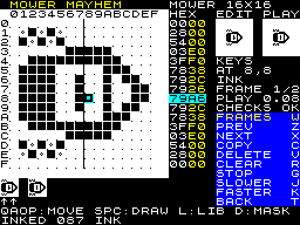
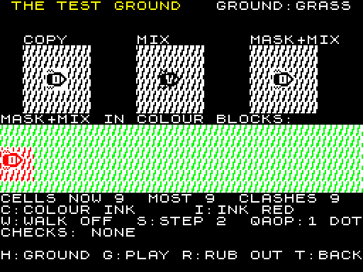
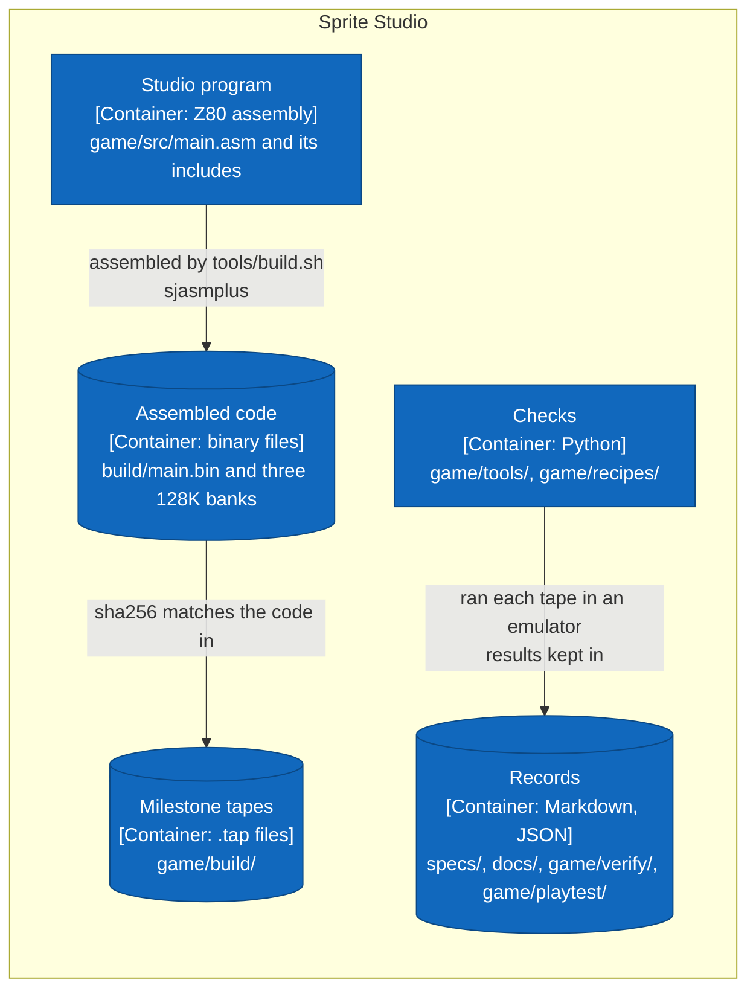

# Sprite Studio

Joo's Sprite Studio is a sprite editor for the ZX Spectrum 128K, written in Z80 assembly, for anyone who wants to
see how a Spectrum sprite is made, square by square and byte by byte.

[](LICENSE)
[-CC%20BY--NC%204.0-lightgrey.svg)](LICENSE-ASSETS.md)
[](#how-to-run)
[-orange.svg)](game/src/)
[](game/tools/)
[](https://youtu.be/kdW7khOQViU)

> **This README is the guide to the repository**: what it can do, where everything is and its current state.
> Last reviewed in full on 21 November 2026; it is updated with every change.



- [At a glance](#at-a-glance)
- [Current state](#current-state)
- [Maps](#maps)
- [What is in this repository](#what-is-in-this-repository)
- [Landmarks](#landmarks)
- [How to run](#how-to-run)
- [Checks and tests](#checks-and-tests)
- [History and decisions](#history-and-decisions)
- [Working in this repository](#working-in-this-repository)
- [Glossary](#glossary)
- [Related repositories](#related-repositories)
- [Licence and credits](#licence-and-credits)

## At a glance

| | |
| --- | --- |
| **What it does** | You draw a sprite square by square, as on squared paper, and see each row's bytes in hex beside it. You see it at true size, add frames and play them as a flip-book. You can work out its mask, and test it over scenery to see colour clash and flicker. You can keep up to eight figures on a sheet, save them to tape, or export them as `DEFB` lines for your own game. It works with keys, a Kempston joystick or a Kempston mouse. |
| **Who it is for** | Anyone learning how Spectrum sprites work, and anyone who wants the source of a complete 128K tool in Z80 assembly. |
| **Play it** | Load [`game/build/sprite-studio-m7.tap`](game/build/sprite-studio-m7.tap) on a 128K Spectrum, a +2 or an emulator. |
| **Run it** | `fuse --machine 128 --kempston-mouse game/build/sprite-studio-m7.tap` |
| **State** | Finished: the seventh and last milestone (M7) passed its checks on 12 November 2026. |
| **Work** | No open issues on 21 November 2026. |
| **Decisions** | [`game/decisions.md`](game/decisions.md) |




## Current state

On 21 November 2026:

- **The Studio is finished.** The M7 tape, `game/build/sprite-studio-m7.tap`, is the latest version. The tapes
  for M1 to M6 beside it are earlier versions. [`game/STATUS.md`](game/STATUS.md) records every step as done.
- **The tutorial is published.** Joo, the studio's sprite artist, shows the Studio and its six lessons in a
  four-minute video, published on 12 November 2026: <https://youtu.be/kdW7khOQViU>. The same video is in this
  repository as [`game/video/tutorial.mp4`](game/video/tutorial.mp4).
- **This repository** was first published on 16 November 2026.

## Maps

**Context: Sprite Studio and who it serves.**

```mermaid
flowchart LR
  user(["User<br/>[Person]<br/>draws and tests sprites"]):::person
  dev(["Developer<br/>[Person]<br/>reads or assembles the source"]):::person
  subgraph boundary [This repository]
    sys["Sprite Studio<br/>[Software system: Z80 assembly]<br/>a 128K sprite editor on tape"]:::internal
  end
  spectrum["Spectrum 128K or emulator<br/>[Software system: Fuse or hardware]<br/>runs the tape"]:::external
  sjasm["sjasmplus 1.24.0<br/>[Software system]<br/>Z80 assembler"]:::external
  youtube["YouTube<br/>[Software system]<br/>the tutorial video"]:::external
  user -->|loads the tape into| spectrum
  spectrum -->|runs| sys
  dev -->|runs tools/build.sh| sjasm
  sjasm -->|assembles game/src/| sys
  user -->|watches the tutorial on| youtube
  classDef person fill:#08427b,stroke:#052e56,color:#ffffff
  classDef internal fill:#1168bd,stroke:#0b4884,color:#ffffff
  classDef external fill:#999999,stroke:#6b6b6b,color:#ffffff
```



Key: dark blue stadium = person; blue box = this repository's system; grey box = a system outside it; arrows read
in the direction of the label.

**Containers: inside Sprite Studio.**



Key: blue box = a part of this repository that runs or is built; blue cylinder = stored files; arrows read in the
direction of the label.

## What is in this repository

| Path | What it holds |
| --- | --- |
| [`game/src/`](game/src/) | The Z80 source: `main.asm` and the files it includes, for sjasmplus 1.24.0. |
| [`game/build/`](game/build/) | The tapes `sprite-studio-m1.tap` to `sprite-studio-m7.tap` (M7 is the latest) and `sheet-check.tap`. |
| [`game/milestones.md`](game/milestones.md), [`game/milestones/`](game/milestones/) | The seven milestones and their gate records. |
| [`game/decisions.md`](game/decisions.md), [`game/design.md`](game/design.md) | The decisions made while building it, and the Spectrum design. |
| [`game/tools/`](game/tools/), [`game/recipes/`](game/recipes/) | The emulator checks and the bot recipes they ran. |
| [`game/verify/`](game/verify/), [`game/playtest/`](game/playtest/) | The results of those checks and the playtest reports (1,794 files together). |
| [`game/library-tapes/`](game/library-tapes/) | The Library's index of figures from Dalex Software's other games. |
| [`game/video/`](game/video/) | The tutorial video, its voice script and timeline, and the end screen. |
| [`game/media-kit/`](game/media-kit/) | The tape-loading video and its posters. |
| [`game/ux/`](game/ux/) | A usability trial and its pictures. |
| [`assets/`](assets/) | The loading and Start screens, their picture sources and working images. |
| [`docs/`](docs/) | The user guide, the build history and the README pictures. |
| [`specs/`](specs/) | The Sprite Studio specification and its notes. |
| [`tools/`](tools/) | `build.sh` and `build.sha256`, to assemble the source and check it. |
| [`LICENSE`](LICENSE), [`LICENSE-ASSETS.md`](LICENSE-ASSETS.md) | The MIT licence for code, and the CC BY-NC 4.0 licence for art, video, audio and text. |
| `.pre-commit-config.yaml` and the lint settings | The commit checks (see [Checks and tests](#checks-and-tests)). |

## Landmarks

1. [`game/build/sprite-studio-m7.tap`](game/build/sprite-studio-m7.tap): the Studio itself.
2. [`docs/studio-guide.md`](docs/studio-guide.md): the user guide, with every control.
3. [`specs/sprite-studio-spec.md`](specs/sprite-studio-spec.md): what the Studio must do.
4. [`game/src/main.asm`](game/src/main.asm): where the program starts.
5. [`docs/how-it-was-built.md`](docs/how-it-was-built.md): the sources, decisions, techniques and checks.
6. [`game/milestones.md`](game/milestones.md): the seven milestones.
7. [`game/video/README.md`](game/video/README.md): how the tutorial was made.

## How to run

1. Get the tape: [`game/build/sprite-studio-m7.tap`](game/build/sprite-studio-m7.tap). It is the latest
   milestone (M7). The tapes for M1 to M6 beside it are earlier versions.
2. Load it on a **128K** Spectrum or a +2. It does not run on a 48K.
3. In the [Fuse](https://fuse-emulator.sourceforge.net/) emulator, with a Kempston mouse:

   ```sh
   fuse --machine 128 --kempston-mouse game/build/sprite-studio-m7.tap
   ```

   Click the Fuse window to let it take the mouse. Other emulators with 128K and Kempston support should
   also work.
4. On the Start screen press **1** for the mouse, or **2** for keys or a joystick.

### Controls

The [user guide](docs/studio-guide.md) lists every control. The main keys on the Desk:

| Key | Does |
| --- | --- |
| Q A O P | move the Grid Cursor (or use a Kempston stick) |
| SPACE / ENTER | paint / rub out (mouse: left / right button) |
| U | undo; press again to redo |
| Z / X | previous / next frame |
| C / V / R | copy / delete / clear the frame |
| G | play or stop the flip-book (J / K: slower / faster) |
| N | tracing paper: the last frame shows as rings |
| I | mirror the frame |
| D | switch between the picture and its mask (F: the mask style) |
| H | the Test Ground: the figure over scenery, with colour clash |
| L | the Library of ready-made figures |
| 0 | the Lessons |
| 9 | the Sheet: several figures, save and load on tape, export |
| T | back |
| M | music on or off (Start screen) |

### Build it from source

The source is in [`game/src/`](game/src/): `main.asm` and the files it includes, for
[sjasmplus](https://github.com/z00m128/sjasmplus) 1.24.0. To assemble it:

```sh
tools/build.sh                       # or: SJASMPLUS=/path/to/sjasmplus tools/build.sh
```

This writes `build/main.bin` (the program) and `build/bank1.bin`, `bank4.bin` and `bank6.bin` (the 128K
memory banks). It then checks their sha256 against [`tools/build.sha256`](tools/build.sha256): they are the
exact code inside `game/build/sprite-studio-m7.tap`.

**What needs private tools.** The Studio was built with a set of private Claude Code plugins. These parts of
the work use them, and are not needed to assemble or run the Studio:

- packing the assembled code into the `.tap`, with its BASIC loader (the committed tapes are the result);
- the emulator checks in [`game/tools/`](game/tools/) and the bot recipes in `game/recipes/`, which run the
  tape in the plugins' Z80 simulator (their results are in `game/verify/` and `game/playtest/`);
- rebuilding the Library (`game/tools/build_library.py`), which reads the other Dalex games' sprite files;
- recording the tutorial video (`game/video/make_tutorial.py`).

## Checks and tests

There is no CI. The repository uses [pre-commit](https://pre-commit.com/) hooks, each pinned to a release:
Gitleaks (secrets), markdownlint, JSON, TOML and YAML checks, whitespace, large files, typos (spelling), ruff
(Python defects) and shellcheck. Run them with:

```sh
pre-commit install
pre-commit run --all-files
```

`tools/build.sh` checks that the assembled code matches the M7 tape byte for byte. Each milestone was also checked
by scripted runs in an emulator and playtested; the results are in `game/verify/` and `game/playtest/`.

## History and decisions

AI coding agents (Claude Code) designed and built Sprite Studio from a written spec, in seven milestones, between
11 and 12 November 2026. The owner set the brief and answered the questions the agents raised. Each milestone was
assembled, checked by scripted runs in an emulator and playtested.
[docs/how-it-was-built.md](docs/how-it-was-built.md) records the sources, decisions, techniques and checks. The
spec is [`specs/sprite-studio-spec.md`](specs/sprite-studio-spec.md),
[`game/milestones.md`](game/milestones.md) lists the milestones, and
[`game/decisions.md`](game/decisions.md) holds every decision. The tutorial was published on 12 November 2026, and
this repository on 16 November 2026.

## Working in this repository

- **Branch**: `main`.
- **Commits**: pass the pre-commit hooks above.
- **Licences**: code changes are MIT; art, video, audio and text are CC BY-NC 4.0. See
  [Licence and credits](#licence-and-credits).

## Glossary

| Term | Meaning |
| --- | --- |
| Desk | The main screen: the Grid, the HEX column, the true-size view and the frame strip. |
| Grid | The squared drawing area; one square is one pixel. |
| Flip-book | The frames played one after another. |
| Mask | The pattern that clears the scenery behind a sprite before it is drawn. |
| Colour clash | The Spectrum's one ink and one paper per 8 by 8 square, which makes colours bleed. |
| Test Ground | The figure over scenery, with its mask and colour clash. |
| Library | Ready-made figures from Dalex Software's other games. |
| Sheet | Up to eight figures, saved to tape or exported as `DEFB` lines. |
| `DEFB` | An assembler line that defines bytes of data. |
| Kempston | The joystick and mouse interfaces the Studio reads. |
| `.tap` | A Spectrum tape image. |
| Milestone (M1 to M7) | One of the seven steps the Studio was built in. |

## Related repositories

| Repository | Visibility | What it is to this repository |
| --- | --- | --- |
| [dalex-software](https://github.com/danielvaughan/dalex-software) | Public | Dalex Software's website, where five of the six games behind the Library's figures can be played in the browser |

## Licence and credits

Made by Daniel Vaughan. Dalex Software is a fictional 1987 software studio, and Joo (Hyun-joo Lee) is its
fictional sprite artist. The Library's figures come from Dalex Software's other games.

- **Code** (Z80 source, Python tools, build and check scripts): [MIT](LICENSE).
- **Art, video, audio and text**: [CC BY-NC 4.0](LICENSE-ASSETS.md). That file lists exactly which files
  it covers.
- **Not covered by either licence**: the Dalex Software name and logo, and its characters (Hyun-joo Lee,
  Michaela Hebden and the rest of the cast). All rights reserved.
